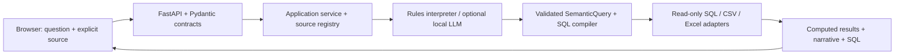

# ADR-001: One service for a synthetic-data BI demo

Status: accepted for the local synthetic demo, 29 October 2026.

## Context

The current release demonstrates aggregate reporting and individual consultant breakdowns using fabricated
records. It does not evaluate actual employees or make actual staffing decisions. The longer-term target is an
internal, organisation-wide application that may process real employee and financial data. Those are separate
release scopes. Keep today's deployment small while preserving useful extension points.

## Decision

Use a modular monolith: one Python process serves the existing browser UI and a FastAPI API. Pydantic validates
incoming requests; the semantic layer still validates business meaning and compiles parameterised SQL.

The diagram shows the conceptual query path. `Registry.ask` delegates to `Engine`, which coordinates the
interpreter, semantic compiler, source and narration. HTTP routes only validate and dispatch; structured queries
and staged uploads are use cases in `BIService`.

| Boundary | Responsibility | Where to extend |
|---|---|---|
| `bi/config.py` | Immutable per-app settings; synthetic profile; local binding | New reviewed deployment profile later |
| `bi/contracts.py` | Typed request schemas and field limits | New API fields and compatibility changes |
| `bi/server.py` | FastAPI app factory, lifecycle, static UI, request boundary | Authentication dependency and identity later |
| `bi/service.py` | Structured query and upload use cases | Saved queries and source administration |
| `bi/registry.py` | Source selection, bootstrap, synthetic upload markers, feeder shutdown | Additional source providers |
| `bi/engine.py` | Interpret, clarify, query, explain | Query orchestration and evaluation |
| `bi/semantic.py` | Metric definitions, validation and SQL compilation | Model adapters and enforced data policy later |
| `bi/sources.py` | Read-only connectors, deadlines, snapshots and file reload | Connection pooling once measured |
| `web/` | Existing HTML/CSS/JS UI, source picker and session conversation | Feedback and saved views |

Source selection happens before interpretation. Explicit selection avoids routing ambiguity and limits the model's
catalogue context. Routing currently uses rules; selecting Auto does not itself call the LLM. The optional local
model is disabled unless configured. Structured breakdown controls call `/api/query` without an LLM. Neither
LangChain nor a vector database is needed for this flow.

### Synthetic profile

- `BI_DATA_CLASSIFICATION` defaults to `synthetic`; other values are rejected in this release.
- Default data directory is `data/synthetic/`, keeping old demo/uploads separate. Existing uploads are not
  automatically migrated or relabelled.
- A configured external source requires `BI_SOURCE_CLASSIFICATION=synthetic`. Use a dedicated mock database
  account and semantic model rather than connecting to a production warehouse.
- The UI has one Synthetic demo label. File imports require a checked declaration, sent as
  `X-Data-Classification: synthetic`; the API independently rejects missing declarations.
- Successful uploads receive a `.classification.json` sidecar. Only marked uploads reload on startup.
- These declarations are provenance records, **not content detection, anonymisation or access control**. A user
  can misdeclare data. Only use fabricated records without real identifiers, free-text employee information or
  links back to actual people. Renaming employees in a real export is not sufficient for this demo's boundary.
- Localhost is the default, with no identity service or multi-user roles. Network binding needs explicit opt-in;
  the demo itself has no authentication. Conversation history remains in the browser session.
- Preserve read-only queries, bound parameters, request/import limits, origin checks and private minimal logs.
  Synthetic data does not make malformed queries or hostile files safe.

### API and lifecycle

`create_app(settings, registry)` supports isolated tests and defers startup IO until the application lifespan.
Startup builds sources; shutdown stops the mock live feeder. Each synchronous use case closes source connections
on the same worker thread that used them. One request remains within the existing engine/snapshot boundary.
Request bodies are bounded even when streamed, body-read time is limited, and at most 16 HTTP requests are active.
SQL deadlines remain separate from HTTP body deadlines; these are not a general job cancellation mechanism.

Request schemas are published at `/api/openapi.json`. Hosted Swagger/ReDoc pages are disabled so the demo does
not fetch external JavaScript. Malformed JSON returns 400, invalid typed fields return 422, oversize requests return
413, unknown datasets return 404, and capacity overflow returns 503. Error payloads avoid echoing request contents.
The existing result, explanation and clarification response formats are preserved.

## Alternatives and trade-offs

| Option | Benefit | Cost / decision |
|---|---|---|
| Keep the custom standard-library HTTP server | No runtime dependencies | Requires maintaining request validation, concurrency and lifecycle infrastructure; replaced by FastAPI |
| Existing UI + FastAPI + governed engine | Clear contracts and swappable modules in one deployable service | Adds three direct runtime dependencies; selected |
| Streamlit + LangChain SQL agent | Quick Python-only prototypes and framework integrations | UI rework and another orchestration abstraction; direct SQL generation would need a different safety design; defer |
| Microservices, queues, vector store | Independent scaling and asynchronous work | Extra infrastructure without measured need; defer |

## Consequences

The demo stays straightforward to run from a repository checkout. Runtime and HTTP-test dependency versions are
recorded in `requirements.lock`; the CI matrix validates supported interpreter versions. Prefer Python 3.12+ for a
new deployment. The current layout expects the repository's `web/` and `semantic/` folders; wheel distribution is
not a supported deployment artifact yet.

There is no SSO, per-user authorisation, persistent chat store, background task queue or production capacity claim.
A synthetic label does not certify GDPR or EU AI Act compliance. Regulatory scope depends on the processing and
intended use, not the environment variable. GDPR Recital 26 distinguishes anonymous information from identifiable
and pseudonymised personal data: [official GDPR text](https://eur-lex.europa.eu/eli/reg/2016/679/oj/eng).
Employee evaluation and staffing use must be assessed before a real-data release against the then-current
[EU AI Act](https://eur-lex.europa.eu/eli/reg/2024/1689), including Article 6 and Annex III employment provisions.
No application-date or blanket exemption is assumed here.

## Implementation and follow-up

Now: versioned metric models, query/import regressions across SQLite/CSV/Excel, optional PostgreSQL integration,
API contract tests, synthetic declarations, one simple local service, and no LLM required.

Before real data: approve intended uses and metric definitions; assess GDPR lawful basis, DPIA requirements and
AI Act applicability with the organisation's DPO/legal owner; add SSO/TLS, server-enforced access and export policy,
retention/deletion, auditable identity, and credential/egress controls. Establish human oversight and a contestability
process for employee-related decisions. Synthetic experiments must not become actual personnel decisions.

Before organisation-wide rollout: test concurrent realistic workloads and recovery/backup, add monitoring and
support ownership, package the application, and add pooling or pre-aggregation only where measurements justify it.
These future controls are documented work, not implemented features of this demo.
